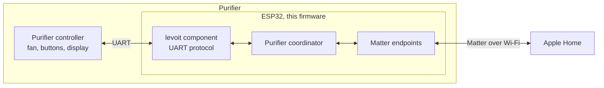
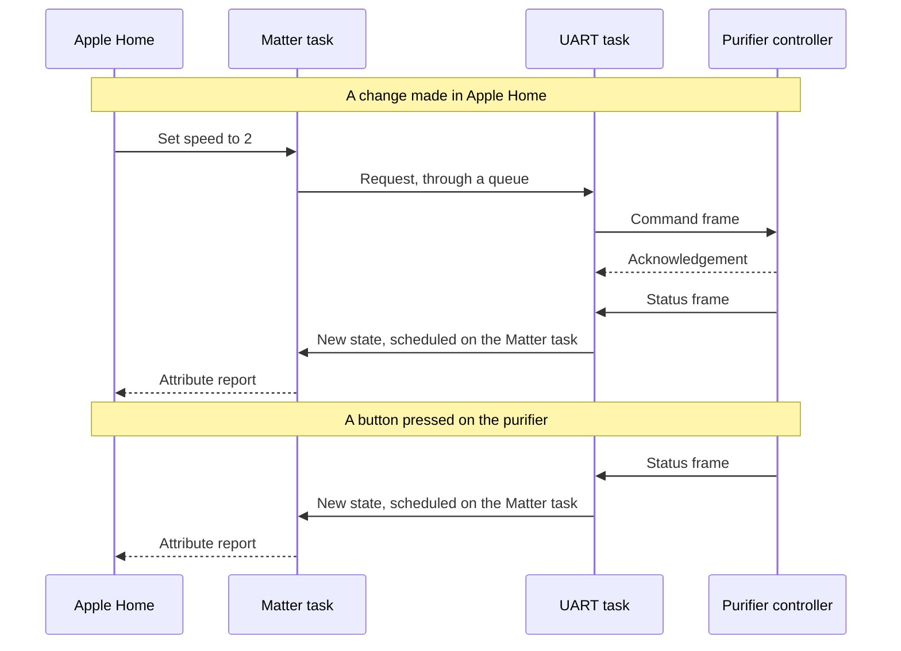

# Design

How the firmware works and why it is built this way. Nothing here has been confirmed on hardware yet.

## What it is

One ESP-IDF application on Espressif's Matter SDK (`espressif/esp_matter` 1.6.1, ESP-IDF 5.5.6). It runs on the purifier's stock ESP32-SOLO-1C and talks to the purifier's own controller over a serial line. The controller keeps running the fan, the buttons and the display. This firmware only replaces the Wi-Fi side.



## Why native, not ESPHome or HomeKit

| Option | Verdict |
|---|---|
| Native esp-matter | Chosen. Bluetooth pairing is the SDK's default path, it uses the least memory, and it depends only on a released SDK. |
| ESPHome with esphome-matter | Works on paper, kept as a separate project. ESPHome and Matter both want to own Wi-Fi, so Bluetooth pairing needs a custom driver hooked into the SDK. It also depends on unmerged changes to an early-stage project. |
| HomeKit | Not built. It has native child lock and filter characteristics that Matter lacks in Apple Home, but it only works with Apple and the available libraries are less maintained. Worth revisiting only if Apple Home renders the Matter purifier badly. |

## Matter data model

| Endpoint | Device type | What it carries |
|---|---|---|
| 1 | Air Purifier | Fan Control with speeds and, where the model has it, Auto. HEPA Filter Monitoring with percent remaining, a change flag and a reset command. |
| 2 | Air Quality Sensor | Air quality level and PM2.5. Omitted on models with no particle sensor. |
| next three | On/Off Plug-in Unit | Sleep, Display, Child Lock |

- **Air quality is on its own endpoint** because Apple ignores measurement clusters attached to another device type.
- **Sleep, Display and Child Lock are switches** because Apple Home has no purifier control for them.
- **Sleep is reported as Low speed.** The purifier runs below speed 1 in Sleep, and Matter has no slower value.

## Structure

| Part | Job |
|---|---|
| `components/levoit` | Everything about the purifier and nothing about Matter. Frame encoding and parsing, the model table, the UART task, mapping between purifier state and Matter values, filter maths. |
| `main/purifier` | The coordinator. Owns purifier state, turns requests into commands, tracks filter use, detects the reset gesture, drives the LEDs. |
| `main/matter_setup` | Builds the endpoints, turns controller writes into requests, pushes state into the clusters. |
| `main/ota` | The update endpoint and the health check that decides whether a new image is kept. |
| `main/commissionable_data` | Supplies the setup code verifier from the factory partition. |

Two tasks do the work. The UART task owns the serial port and all purifier state. The Matter task owns every cluster object. They talk through one queue in each direction, so neither touches the other's data.



## Rules the code follows

- **The purifier is the source of truth.** Panel buttons change state without Matter knowing, so Matter's values are always a copy of the last status.
- **Nothing is sent until the first status arrives.** Matter restores stored values at boot. Acting on them would change the purifier on every power cut.
- **Send only what changed.** Turning a switch off never powers the purifier on.
- **Commands wait for an acknowledgement**, with three attempts and a gap between frames.
- **Controls are held for two seconds after a command**, so a status frame sent just before the purifier applied it does not make the slider snap back.
- **If the purifier goes quiet for five seconds, ask for status.** Some models only report on change.

## Models

Everything model-specific is one row in `components/levoit/src/levoit_core.cpp`: speed count, airflow rating, status frame type and byte positions, status request command, and which acknowledgement the controller expects.

Adding a Core model is a new row, a Kconfig entry and a recorded status frame in the tests. The Vital, Sprout and EverestAir families use a different frame format and would need their own decoder.

## Purifier protocol

The ESP32 and the purifier's controller talk over UART at 115200 8N1. On the Core 300S the ESP32 transmits on GPIO17 and receives on GPIO16.

### Where this comes from

| Source | What we took from it |
|---|---|
| [tuct/levoit](https://github.com/tuct/levoit), `LEVOIT_UART.md` and the driver source | Frame format, every command we send, the status layouts for the Core 200S, 400S and 600S, the airflow ratings, and the acknowledgement it sends |
| [tuct/levoit device captures](https://github.com/tuct/levoit/tree/main/devices) | Recordings of stock firmware on a Core 200S and 600S. The test vectors for those models come from here. |
| [mulcmu/esphome-levoit-core300s](https://github.com/mulcmu/esphome-levoit-core300s) | The byte-by-byte Core 300S status layout, including the two display bytes and the running speed, and the status request |
| [Levoit Core 300S user manual](https://files.vesync.com/desc/LEVOIT_Core300S_USER_MANUAL.pdf) | Which buttons do what, the air quality levels and the speed Auto runs at for each, and the filter reset |
| This project | The items under "Found on our hardware" below, from a Core 300S whose controller reports version 1.0.0 |

### Frame

```
A5  type  counter  length  00  checksum  cmd0 cmd1 cmd2  00  payload...
```

- `type`: `22` is a message, `12` an acknowledgement, `52` a second kind of acknowledgement.
- `length`: the number of bytes after the checksum.
- `checksum`: `FF` minus the low byte of the sum of every other byte.
- An acknowledgement repeats the command bytes and the counter of the message it answers.

### Commands the firmware sends

All from tuct/levoit.

| Command | Payload | Does |
|---|---|---|
| `01 00 A0` | `00` or `01` | Power off or on |
| `01 60 A2` | `01 01 <speed>` | Manual speed |
| `01 E0 A5` | `00`, `01`, `02` | Mode: manual, sleep, auto |
| `01 05 A1` | `00` or `64` | Display off or on |
| `01 00 D1` | `00` or `01` | Child lock |
| `01 E2 A5` | `00` or `01` | Filter light |
| `01 29 A1` | six bytes | Wi-Fi light: off, solid, blinking |
| `01 31 40` | none | Ask for status (Core 300S and 400S). `01 61 40` on the 200S. |

### Status from the controller

| Model | Command | Length | Source |
|---|---|---|---|
| Core 200S | `01 60 40` | 12 | tuct capture |
| Core 300S | `01 30 40` or `01 B0 40` | 18 | mulcmu, tuct |
| Core 300S, controller 1.0.0 | `01 32 40` | 19 | Found on our hardware |
| Core 400S | `01 30 40` or `01 B0 40` | 18 | tuct |
| Core 600S | `01 40 41` | 22 | tuct capture |

### Found on our hardware

None of this is in the sources above. It was read off a Core 300S over the firmware's own log.

**Status `01 32 40`, 19 bytes.** The 18-byte layout with one byte inserted at offset 6.

| Offset | Meaning | Values seen |
|---|---|---|
| 0 to 2 | Controller version: patch, minor, major | `00 00 01` |
| 3 | Power | `00`, `01` |
| 4 | Mode | `00` manual, `01` sleep, `02` auto |
| 5 | Selected manual speed. Kept while off and in auto. | `01` to `03` |
| 6 | Unknown, the inserted byte | `00` |
| 7 | Display backlight now | `00`, `64` |
| 8 | Display setting | `00` off, `01` on |
| 9 | Running speed | Equals the speed in manual, `00` in auto with clean air, `FF` when off |
| 10 | Filter light | `00` off, `01` on. Follows the `01 E2 A5` command. |
| 11 | Air quality level, 1 best to 4 | `01` |
| 12 to 13 | PM2.5, little endian | `01 00`, `05 00`, `07 00` |
| 14 | Child lock | `00` |
| 15 | Auto profile | `00` |
| 16 to 17 | Room size for the auto profile | `00 00` |
| 18 | Error | `00` |

Offset 9 as "running speed" matches mulcmu's description of the same field in the 18-byte layout. We have not yet seen it rise in auto.

**The two display bytes behave differently.** With the display set to off, touching any button lights the backlight for about three seconds. Offset 7 goes to `64` and back to `00`. Offset 8 stays `00`. The firmware reports offset 8.

**This controller pushes status once a minute and on every change.** It does not send it several times a second, as the older captures show.

**The status request is acknowledged with no payload** on this controller. On the older Core 300S in mulcmu's captures, and on the Core 200S in tuct's, the acknowledgement carries the status. So here the firmware has to wait for a push. One arrives shortly after any command, including the Wi-Fi light command sent at boot.

**Button hold, `01 02 D1`.** Sent when the Wi-Fi button is held.

| Payload | When |
|---|---|
| `02` | The hold registers, a few seconds after the press |
| `03` | The button is released |

A five-second hold produced `02` then `03` 0.7 seconds later. A longer one produced `02` then `03` 7.6 seconds later. The firmware resets to pairing mode when the button is still held five seconds after `02`. Whether a much longer hold produces further payloads is untested.

**Filter reset, `01 E4 A5` with payload `00`.** Sent when the Sleep button is held for three seconds, which is the reset the manual describes. tuct documents this message for the Core 200S. We confirmed this Core 300S sends it too. The controller turns its filter light off itself, and offset 10 goes back to `00`. A hold that is too short is taken as a tap and toggles Sleep. The filter symbol on the panel is an indicator, not a button, and holding it sends nothing.

**Acknowledgements.** The firmware answers every message with the form tuct's driver uses: type `12`, its own counter, byte 4 set to `FF`. This controller accepts it and does not repeat itself.

### Seen in other people's captures

Read from tuct's recordings, and not written down there as far as we found.

- **Stock firmware acknowledges status with type `52`**, echoing the controller's counter, with a trailing `01`: `A5 52 00 04 00 62 01 60 40 01` on the 200S and the same shape on the 600S. The 200S and 600S rows use this form.
- **The stock 200S firmware sends `01 61 40` at boot** and receives the status in the acknowledgement.

### Apple Home's Matter behaviour

Also observed, and worth knowing for anyone building a purifier.

| What you do in Home | What Home sends |
|---|---|
| Tap Auto while off | FanMode Auto, then FanMode High 40 ms later |
| Tap Manual while off | FanMode High |
| Drag the slider | A stream of PercentSetting writes |
| Tap Off | FanMode Off |

- Home treats High as "turn on". The firmware ignores a High that follows Auto within 1.5 seconds, and otherwise resumes the last manual speed.
- Home does not read names for the parts of a device from semantic tag labels. Fixed Label and User Label are reported not to work either.
- Home shows Matter's best air quality value, Good, one step below its own Excellent.
- The default accessory name is always "Matter Accessory" for an uncertified device.

## Filter life

The purifier does not report filter life. Stock firmware kept the count, so a freshly flashed purifier starts at 100% and `tools/filter.sh` sets the real figure. The firmware counts airflow: each minute it adds the model's airflow rating scaled by the current speed, with Sleep counted as 63 percent of speed 1. Life is the share of six months at full speed that remains. The count is saved every 30 minutes and when the purifier turns off. Holding the Sleep button for three seconds clears the count, as it does on stock firmware. Matter's reset command also works, but Apple Home has no button for it.

## Pairing and reset

- Each purifier has its own random setup code, made by `tools/factory.sh` with Espressif's manufacturing tool. The purifier holds only the verifier, salt, iteration count and discriminator, in a factory partition that updates and factory resets never touch. The code itself exists only on the label.
- Without factory data the firmware falls back to the public test code and logs a warning.
- The attestation certificate is still the SDK's test one, so Apple Home shows the uncertified prompt. A real one needs a vendor ID.
- Bluetooth is only used for pairing and is shut down afterwards to free memory. It cannot be restarted without a reboot.
- That is why removing the purifier from its last controller does a full factory reset: it is the only way back to pairing mode.
- The purifier's controller reports a long press of its Wi-Fi button as `01 02 D1`, with payload 2 when the hold registers and 3 on release. Five seconds of holding after that first message triggers a factory reset. An earlier design counted display toggles, which was easy to trigger by accident.
- Matter's Identify command inverts the Wi-Fi light for its duration.

## Updates

Apple Home can serve Matter updates, but only ones published to the Matter ledger under a vendor account, which this project does not have. So updates are an authenticated `POST /ota` on the purifier.

The token is per purifier. `tools/factory.sh` generates it and stores only a salted SHA-256 hash in the factory partition. `POST /ota/token`, authorised with the current token, replaces it with a new hash in the settings area. A factory reset removes that replacement, so the factory token works again. That keeps a forgotten token recoverable without a serial cable, at the cost that a reset undoes a change of token.

A purifier with no token in its factory data does not start the update server. The new image is kept only if, within two minutes of booting, the network is up, the update endpoint is running and the purifier is answering on the serial line. Otherwise the bootloader returns to the previous image. An image that cannot be updated again is never kept.

## Testing

- `components/levoit/host_test/run.sh` runs the unit tests on the build machine. They cover framing, decoding for each model, the mapping rules above and filter maths, using frames recorded from stock firmware where they exist.
- `tools/mcu_sim.py` stands in for the purifier's controller on a serial port, for testing on a dev board.

## Open questions

- Free memory during Bluetooth pairing on the single-core chip.
- Whether the Core 300S answers the status request. The 200S does, in a recording of stock firmware.
- Which acknowledgement the 300S controller prefers. Stock firmware on the 200S and 600S uses a different one from the community driver this follows.
- How Apple Home renders Auto mode and filter status.
- What byte 17 of the 300S status means.
