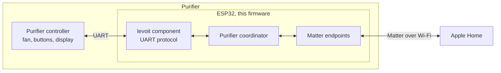
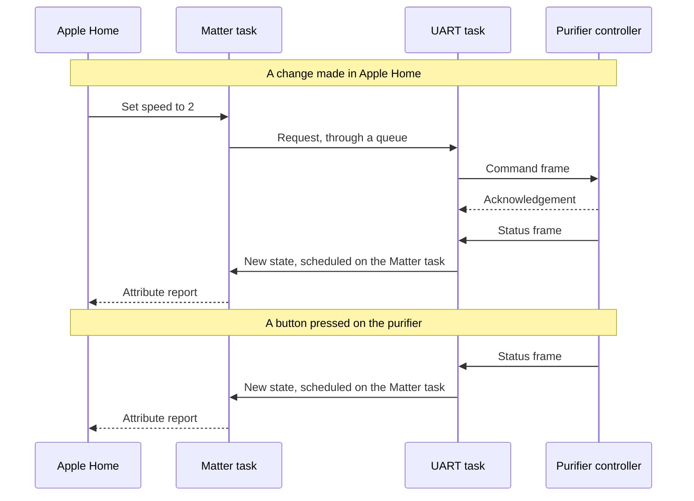

# Design

How the firmware works and why it is built this way. Nothing here has been confirmed on hardware yet.

## What it is

One ESP-IDF application on Espressif's Matter SDK (`espressif/esp_matter` 1.6.1, ESP-IDF 5.5.6). It runs on the purifier's stock ESP32-SOLO-1C and talks to the purifier's own controller over a serial line. The controller keeps running the fan, the buttons and the display. This firmware only replaces the Wi-Fi side.

## Why native, not ESPHome or HomeKit

| Option | Verdict |
|---|---|
| Native esp-matter | Chosen. Bluetooth pairing is the SDK's default path, it uses the least memory, and it depends only on a released SDK. |
| ESPHome with esphome-matter | Works on paper, kept as a separate project. ESPHome and Matter both want to own Wi-Fi, so Bluetooth pairing needs a custom driver hooked into the SDK. It also depends on unmerged changes to an early-stage project. |
| HomeKit | Not built. It has native child lock and filter characteristics that Matter lacks in Apple Home, but it only works with Apple and the available libraries are less maintained. Worth revisiting only if Apple Home renders the Matter purifier badly. |

## Matter data model

| Endpoint | Device type | What it carries |
|---|---|---|
| 1 | Air Purifier | Fan Control with speeds and, where the model has it, Auto. HEPA Filter Monitoring with percent remaining, a change flag and a reset command. |
| 2 | Air Quality Sensor | Air quality level and PM2.5. Omitted on models with no particle sensor. |
| next three | On/Off Plug-in Unit | Sleep, Display, Child Lock |

- **Air quality is on its own endpoint** because Apple ignores measurement clusters attached to another device type.
- **Sleep, Display and Child Lock are switches** because Apple Home has no purifier control for them.
- **Sleep is reported as Low speed.** The purifier runs below speed 1 in Sleep, and Matter has no slower value.

## Structure

| Part | Job |
|---|---|
| `components/levoit` | Everything about the purifier and nothing about Matter. Frame encoding and parsing, the model table, the UART task, mapping between purifier state and Matter values, filter maths. |
| `main/purifier` | The coordinator. Owns purifier state, turns requests into commands, tracks filter use, detects the reset gesture, drives the LEDs. |
| `main/matter_setup` | Builds the endpoints, turns controller writes into requests, pushes state into the clusters. |
| `main/ota` | The update endpoint and the health check that decides whether a new image is kept. |
| `main/commissionable_data` | Supplies the setup code verifier from the factory partition. |

Two tasks do the work. The UART task owns the serial port and all purifier state. The Matter task owns every cluster object. They talk through one queue in each direction, so neither touches the other's data.

## Rules the code follows

- **The purifier is the source of truth.** Panel buttons change state without Matter knowing, so Matter's values are always a copy of the last status.
- **Nothing is sent until the first status arrives.** Matter restores stored values at boot. Acting on them would change the purifier on every power cut.
- **Send only what changed.** Turning a switch off never powers the purifier on.
- **Commands wait for an acknowledgement**, with three attempts and a gap between frames.
- **Controls are held for two seconds after a command**, so a status frame sent just before the purifier applied it does not make the slider snap back.
- **If the purifier goes quiet for five seconds, ask for status.** Some models only report on change.

## Models

Everything model-specific is one row in `components/levoit/src/levoit_core.cpp`: speed count, airflow rating, status frame type and byte positions, status request command, and which acknowledgement the controller expects.

Adding a Core model is a new row, a Kconfig entry and a recorded status frame in the tests. The Vital, Sprout and EverestAir families use a different frame format and would need their own decoder.

## Filter life

The purifier does not report filter life. The firmware counts airflow: each minute it adds the model's airflow rating scaled by the current speed, with Sleep counted as 63 percent of speed 1. Life is the share of six months at full speed that remains. The count is saved every 30 minutes and when the purifier turns off. Resetting the filter in Home, or with the purifier's own filter button where the model reports it, clears the count.

## Pairing and reset

- Each purifier has its own random setup code, made by `tools/factory.sh` with Espressif's manufacturing tool. The purifier holds only the verifier, salt, iteration count and discriminator, in a factory partition that updates and factory resets never touch. The code itself exists only on the label.
- Without factory data the firmware falls back to the public test code and logs a warning.
- The attestation certificate is still the SDK's test one, so Apple Home shows the uncertified prompt. A real one needs a vendor ID.
- Bluetooth is only used for pairing and is shut down afterwards to free memory. It cannot be restarted without a reboot.
- That is why removing the purifier from its last controller does a full factory reset: it is the only way back to pairing mode.
- The purifier's controller reports a long press of its Wi-Fi button as `01 02 D1`, with payload 2 when the hold registers and 3 on release. Five seconds of holding after that first message triggers a factory reset. An earlier design counted display toggles, which was easy to trigger by accident.
- Matter's Identify command inverts the Wi-Fi light for its duration.

## Updates

Apple Home can serve Matter updates, but only ones published to the Matter ledger under a vendor account, which this project does not have. So updates are an authenticated `POST /ota` on the purifier.

The token is per purifier. `tools/factory.sh` generates it and stores only a salted SHA-256 hash in the factory partition. `POST /ota/token`, authorised with the current token, replaces it with a new hash in the settings area. A factory reset removes that replacement, so the factory token works again. That keeps a forgotten token recoverable without a serial cable, at the cost that a reset undoes a change of token.

A purifier with no token in its factory data does not start the update server. The new image is kept only if, within two minutes of booting, the network is up, the update endpoint is running and the purifier is answering on the serial line. Otherwise the bootloader returns to the previous image. An image that cannot be updated again is never kept.

## Testing

- `components/levoit/host_test/run.sh` runs the unit tests on the build machine. They cover framing, decoding for each model, the mapping rules above and filter maths, using frames recorded from stock firmware where they exist.
- `tools/mcu_sim.py` stands in for the purifier's controller on a serial port, for testing on a dev board.

## Open questions

- Free memory during Bluetooth pairing on the single-core chip.
- Whether the Core 300S answers the status request. The 200S does, in a recording of stock firmware.
- Which acknowledgement the 300S controller prefers. Stock firmware on the 200S and 600S uses a different one from the community driver this follows.
- How Apple Home renders Auto mode and filter status.
- What byte 17 of the 300S status means.
