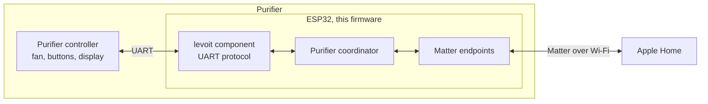
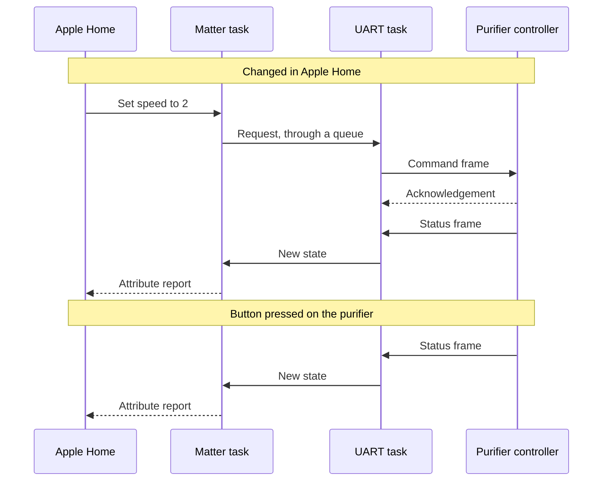

# Design

## What it is

One ESP-IDF application on Espressif's Matter SDK (`espressif/esp_matter` 1.6.1, ESP-IDF 5.5.6), running on the purifier's stock ESP32-SOLO-1C.

The purifier has its own controller, which runs the fan, the buttons and the display. The ESP32 is only the Wi-Fi side. We replace its firmware and leave the controller alone.



## Why not ESPHome or HomeKit

| Option | Verdict |
|---|---|
| Native esp-matter | This. Bluetooth pairing is the SDK's normal path, memory use is lowest, and the only dependency is a released SDK. |
| ESPHome with esphome-matter | Kept as [a separate project](https://github.com/tadhglewis/esphome-levoit-matter). ESPHome and Matter both want to own Wi-Fi, so Bluetooth pairing needs a custom driver, and it depends on changes that are not upstream. |
| HomeKit | Not built. It would fix most of the Apple Home limits. It costs QR-code Wi-Fi setup and every controller that is not Apple's. |

## Matter data model

| Endpoint | Device type | Clusters |
|---|---|---|
| 1 | Air Purifier | Fan Control, On/Off, HEPA Filter Monitoring |
| 2 | Air Quality Sensor | Air Quality, PM2.5. Left out on models with no particle sensor. |
| 3 to 5 | On/Off Plug-in Unit | Sleep, Display, Child Lock |

Why it looks like this:

- Air quality has its own endpoint because Apple ignores measurement clusters hung off another device type.
- Sleep, Display and Child Lock are plug-in units because Apple Home has no purifier control for any of them, and an outlet is the least misleading tile on offer.
- The purifier has an On/Off cluster because Apple Home needs one. Without it, Home turns the purifier on by writing FanMode High, which fights with setting Auto.
- The fan modes are Off, High and Auto (Off and High on the 200S). The purifier has Manual and Auto, and its speeds are SpeedSetting and PercentSetting. With Low and Medium advertised, High meant top speed, but Apple Home writes High for Manual, so picking Manual from off jumped to speed 3. With High the only manual mode, its range is every speed, and the spec leaves the speed within it to the device: the last manual speed.
- Sleep reports as the lowest speed. The fan runs slower than speed 1 in Sleep and Matter has nothing below it.
- Sleep is also the fan's "sleep wind" setting, which the spec defines as slowing to a final minimum speed. That is Matter's own slot for it. Apple Home does not show wind settings, so the Sleep switch stays. Other controllers can show it as a fan mode. Writing it from the matter.js shell puts the purifier in Sleep and back. No controller with a screen has been tried.
- Child lock is also Basic Information's LocalConfigDisabled, which the spec defines as disabling configuration through the device's own interface. Same reasoning, and the same test: writing it from the matter.js shell moved the Child Lock switch both ways. The spec says that setting must never block a factory reset. Here it does, at first: the controller ignores On/Off while locked, as the manual says of every button (page 9), so the reset hold never reaches us. The lock comes off at the panel, though, and then the hold works. So the reset is two steps from the purifier, never out of reach. Removing the purifier from its controller resets it either way.
- The purifier's four air quality levels are sent as Good, Good, Moderate and Poor. Levoit calls the first two "very good" and "good". Apple Home shows only three levels for Matter, so two had to share, and this keeps the step from fine to getting worse visible.

## Code

| Part | Job |
|---|---|
| `components/levoit` | The purifier, with no Matter in it. Framing, the model table, the UART task, mapping purifier state to Matter values, filter maths. |
| `main/purifier` | Owns purifier state. Turns requests into commands, counts filter use, handles the reset hold, drives the lights. |
| `main/matter_setup` | Builds the endpoints, turns controller writes into requests, pushes state into the clusters. |
| `main/ota` | Update, log and filter endpoints, and the check that decides whether a new image stays. |
| `main/commissionable_data` | Reads the setup code verifier from the factory partition. |
| `main/device_info` | Vendor and product names, product URL, and child lock as LocalConfigDisabled. |

Two tasks. The UART task owns the serial port and all purifier state. The Matter task owns every cluster. One queue runs each way between them, so neither touches the other's data.



## Rules

- The purifier is the source of truth. Its buttons change state without asking Matter, so Matter's values are a copy of the last status.
- Nothing is sent until the first status arrives. Matter restores stored values at boot, and acting on them would change the purifier after every power cut.
- Send only what changed. Turning a switch off never powers the purifier on.
- Commands wait for an acknowledgement, three attempts, with a gap between frames.
- After a command the firmware holds the value it asked for, for two seconds. A status frame sent just before the purifier applied the command would otherwise make the control snap back.
- No timing tricks to guess what a controller meant. We tried two. The fix was the On/Off cluster.
- Show what the panel shows. In Sleep and while off the panel is dark, so Display reads off, though the purifier keeps the setting. Turning Display on then fails, so the controller never shows it on and nothing changes out of sight. Matter's answer for a request the current state cannot carry out is a refusal, not a success the device then contradicts.
- Leaving Sleep sends Manual only. The purifier keeps the last manual speed through Sleep and resumes it.
- Whatever the firmware drives on the purifier, it sets once after boot. The filter light may have been left on by other firmware.

## Models

The UART protocol comes from [tuct/levoit](https://github.com/tuct/levoit)'s shared core in `third_party/levoit`: framing, acknowledgements, every model's status decoder and command builder, and filter tracking. This firmware maps the core's state to Matter.

What is model-specific here is one row in `components/levoit/src/purifier_model.cpp`: name, speed count, airflow, Auto and PM2.5. A new Core model is a row and a Kconfig entry. Vital, Sprout, EverestAir and Eleva need their own mode mapping, and the ESP32-C3 boards another build: https://github.com/tadhglewis/levoit-matter/issues/7.

## Filter life

The purifier does not track it. Stock firmware did, on the ESP32, which is why a freshly flashed purifier reads 100%.

Each minute the firmware adds the model's airflow scaled by the current speed, with Sleep counted as 63% of speed 1. Filter life is what remains of six months at full speed. The count is saved every 30 minutes and when the purifier turns off.

Holding Sleep for three seconds clears it, as on stock. `tools/filter.sh` sets it to any value.

## Pairing and reset

- Each purifier gets a random setup code from `tools/factory.sh`, which uses Espressif's manufacturing tool. The chip stores the verifier, salt, iteration count and discriminator in a factory partition that updates and resets never touch. The code itself exists only on the label.
- With no factory data the firmware uses the public Matter test code and logs a warning.
- The attestation certificate is the SDK's test one. A real one needs a vendor ID. That is why Home says "uncertified".
- Bluetooth is used for pairing and then shut down to free memory. It cannot restart without a reboot. So removing the purifier from its last controller triggers a full factory reset, which is the only way back to pairing mode.
- The purifier's controller reports a held On/Off button. The manual's own reset is a 15-second hold of On/Off (page 7). Eleven seconds of holding after the first report, about fifteen from the press, triggers a factory reset. An earlier build could reset the moment the hold registered: the hold was timestamped a few milliseconds after the clock reading used to check it, and the unsigned subtraction wrapped. There is a test for it now.
- Identify inverts the Wi-Fi light.

## Updates

Updates are Matter OTA. The purifier is an OTA Requestor (`CONFIG_ENABLE_OTA_REQUESTOR`). The build also writes `levoit_matter-ota.bin`: the app image behind a Matter header with vendor ID, product ID, version and a SHA-256 of the payload.

Apple Home could deliver them, but only ones published to the Matter ledger under a vendor account. We have no vendor account. So `tools/matter-ota.sh` is the provider: `tools/matter-ota/matter-ota.mjs`, a controller on the [matter.js](https://github.com/matter-js/matter.js) API, with its packages pinned by `pnpm-lock.yaml` and its storage in `devices/<name>/matter/`. It has an OTA Provider endpoint, which lets its fabric use it, and allows test vendor IDs.

1. `pair` commissions it as a second controller with a code from Turn On Pairing Mode.
2. `update` stores the image, connects, subscribes, checks the purifier's vendor ID, product ID and version against the image, and sends AnnounceOTAProvider.
3. The purifier sends QueryImage with its vendor ID, product ID and version. The provider offers the image only if the IDs match and its version is higher.
4. The purifier pulls the image over BDX, in 1024-byte blocks with one round trip each, on the CASE session. About 47 seconds for 1.5 MB. It strips the header and streams the payload through `esp_ota_write`. `esp_ota_end` checks the ESP image and its appended SHA-256.
5. ApplyUpdateRequest, the provider says proceed, the purifier switches boot slot and reboots. After the reboot it compares its version with the target and reports NotifyUpdateApplied, which the tool waits for.

The SDK never marks the new image valid. That stays with the health check below, however the image arrived.

While the running image is unconfirmed, the other slot holds the last good one, and an update would write over it. So both routes refuse until the health check below has confirmed the running image, usually within four seconds of boot. For Matter that is our requestor driver, a subclass of the SDK's `ExtendedOTARequestorDriver` that cancels in `UpdateAvailable`, before any download, whichever provider sent it. A refusal shows up as the requestor going from Querying straight back to Idle. The tool takes that as not yet and retries every 20 seconds for two and a half minutes, longer than the health check's deadline.

The image is not signed. Any controller on a fabric can install any image. That is narrower than the HTTP token, which anyone on the network could read.

Home Assistant's Matter Server is an OTA provider too. python-matter-server loads local updates from JSON files in its OTA provider folder, each pointing at an `.ota` file, and offers them to devices whose IDs match ([source](https://github.com/home-assistant-libs/python-matter-server/tree/main/matter_server/server/ota)). Our test vendor ID needs its test-net setting on. Not tried.

`CONFIG_LEVOIT_HTTP_OTA` adds the old route, for development: `POST /ota` with the token, as plain HTTP. About ten seconds, any version, any image. Anyone who can read your Wi-Fi traffic can take the token and replace the firmware. Off by default.

The token is per purifier. `factory.sh` generates it and stores a salted SHA-256 hash in the factory partition. It guards `/log`, `/filter` and, when built in, `/ota`. `POST /ota/token`, authorised with the current token, replaces it. A factory reset removes the replacement. With no token in the factory data the HTTP server does not start.

A new image stays only if, within two minutes of booting, the network is up, the purifier's controller is answering and, when the purifier has a token, the HTTP server is running. Otherwise the bootloader goes back to the previous image.

## Tests

`components/levoit/host_test/run.sh` runs on the build machine. It covers framing, decoding for each model, the mapping rules and the filter maths, using frames captured from real purifiers where we have them.

`tools/mcu_sim.py` plays the purifier's controller on a serial port.

Nothing tests the Matter side off the device.

## Resources

Measured on the Core 300S on 2026-11-25, version 0.5.0, ESP-IDF 5.5.6 and esp-matter 1.6.1.

| | Size | Of |
|---|---|---|
| Firmware image | 1.48 MB | 1.94 MB app slot, 73% |
| Static DRAM | 103 KB | 124 KB, 83% |
| IRAM | 101 KB | 128 KB, 77% |

Running and paired, from the log's once-a-minute report:

| | Value |
|---|---|
| Free heap | 111 KB, flat over 40 minutes |
| Largest free block | 27.6 KB |
| Lowest free heap since boot | 19.7 KB. 9.6 KB was seen once during Bluetooth pairing on an earlier build. |
| Free stack: Matter / purifier link / update server / main | 4.1 / 3.6 / 3.6 / 5.7 KB, of 10 / 6 / 6 / 8 KB |

Timings:

| | Time |
|---|---|
| First build | About 15 minutes |
| Build after a code change | 1 to 3 minutes. Changing a build option rebuilds most of the SDK, about 20 minutes. |
| Update over Wi-Fi | About 12 s to send the 1.48 MB image, then the reboot |
| From boot to the new image confirmed healthy | About 4 s |
| From boot to the first purifier status | About 2 s |

## Purifier protocol

UART, 115200 8N1. On the Core 300S the ESP32 transmits on GPIO17 and receives on GPIO16.

### Sources

| Source | What it gave us |
|---|---|
| [tuct/levoit](https://github.com/tuct/levoit) | Frame format, the commands, status layouts for the 200S, 400S and 600S, airflow ratings |
| [tuct/levoit device captures](https://github.com/tuct/levoit/tree/main/devices) | Stock firmware recordings from a 200S and a 600S. Our test vectors for those. |
| [mulcmu/esphome-levoit-core300s](https://github.com/mulcmu/esphome-levoit-core300s) | The 300S status layout byte by byte, and the status request |
| [Levoit Core 300S manual](https://files.vesync.com/desc/LEVOIT_Core300S_USER_MANUAL.pdf) | What the buttons do, and the speed Auto runs at for each air quality level |
| A backup of our own purifier's stock firmware | Function names beside command numbers |
| Our purifier's log | Everything under "What we found" |

### Frame

```
A5  type  counter  length  00  checksum  cmd0 cmd1 cmd2  00  payload...
```

- `type` is `22` for a message, `12` for an acknowledgement, `52` for a second kind of acknowledgement.
- `length` counts the bytes after the checksum.
- `checksum` is `FF` minus the low byte of the sum of every other byte.
- An acknowledgement repeats the command and counter of the message it answers.

### Commands we send

| Command | Payload | Does |
|---|---|---|
| `01 00 A0` | `00` or `01` | Power |
| `01 60 A2` | `01 01 <speed>` | Manual speed |
| `01 E0 A5` | `00`, `01`, `02` | Mode: manual, sleep, auto |
| `01 05 A1` | `00` or `64` | Display |
| `01 00 D1` | `00` or `01` | Child lock |
| `01 E2 A5` | `00` or `01` | Filter light |
| `01 29 A1` | six bytes | Wi-Fi light: off, solid, blinking |
| `01 31 40` | none | Status request, 300S and 400S as documented by others |
| `01 33 40` | none | Status request, 300S controller 1.0.0 |
| `01 61 40` | none | Status request, 200S |

### Status

| Model | Command | Length | Source |
|---|---|---|---|
| Core 200S | `01 60 40` | 12 | tuct capture |
| Core 300S | `01 30 40` or `01 B0 40` | 18 | mulcmu, tuct |
| Core 300S, controller 1.0.0 | `01 32 40` | 19 | Ours, now in tuct |
| Core 400S | `01 30 40` or `01 B0 40` | 18 | tuct |
| Core 600S | `01 40 41` | 22 | tuct capture |

### What we found

On a Core 300S whose controller reports version 1.0.0. None of it was in the sources above. Most of it is now in tuct/levoit.

**Status `01 32 40`.** The 18-byte layout with one byte inserted at offset 6.

| Offset | Meaning | Seen |
|---|---|---|
| 0 to 2 | Controller version: patch, minor, major | `00 00 01` |
| 3 | Power | `00`, `01` |
| 4 | Mode | `00` manual, `01` sleep, `02` auto |
| 5 | Selected manual speed. Kept while off and in auto. | `01` to `03` |
| 6 | Unknown | `00` |
| 7 | Display backlight right now | `00`, `64` |
| 8 | Display setting | `00`, `01` |
| 9 | Running speed | The speed in manual. `00` in auto with clean air, which is sleep speed. `FF` when off. |
| 10 | Filter light | `00`, `01` |
| 11 | Air quality, 1 best to 4 | `01` |
| 12 to 13 | PM2.5, little endian | `01 00` to `07 00` |
| 14 | Child lock | `00` |
| 15 | Auto profile | `00` default, `01` quiet, `02` room size. Follows `01 E6 A5`. |
| 16 to 17 | Room size, little endian | As sent in `01 E6 A5`. Kept after the profile goes back to default. |
| 18 | Unknown. The older layout has an error flag here. | `00`, `01`. We saw `01` in normal running, so it is not an error. |

We have not watched offset 9 rise in auto. The reading matches mulcmu's notes on the same field in the 18-byte layout.

**Two display bytes.** With the display set to off, any button lights the backlight for three seconds. Offset 7 goes to `64` and back. Offset 8 stays `00`. Read offset 8. We read offset 7 first. Back when the reset counted display changes, three button presses with the display off would have factory-reset the purifier.

**Status request is `01 33 40`.** This controller acknowledges the documented `01 31 40` with an empty payload. The stock firmware names `01 33 40` as `purifier_uart_query_device_status`, and the reply is an acknowledgement carrying the 19-byte status. The firmware sends `01 33 40` every 5 s while no status has arrived.

**Status is pushed once a minute and on every change.** Other people's captures show it several times a second.

**Version 1.0.0 is not "old".** tuct lists controller versions 2.0.7 and 2.0.11 as tested on the 300S, both on the 18-byte status. Ours reports 1.0.0 beside a stock ESP32 image from February 2025, on a UAE-region unit (LAP-C302S-WGC). So this is a different controller line, not an earlier one.

The raw frames behind all of this, both directions, are in [`status_32_40.txt`](https://github.com/tuct/levoit/blob/main/devices/levoit-core300s/uart/status_32_40.txt) in tuct/levoit. The decoder ([#140](https://github.com/tuct/levoit/pull/140)) and the status request ([#141](https://github.com/tuct/levoit/pull/141)) are merged there. The panel filter reset ([#142](https://github.com/tuct/levoit/pull/142)), the On/Off hold ([#143](https://github.com/tuct/levoit/pull/143)) and plasma ([#144](https://github.com/tuct/levoit/pull/144)) are open.

**Button hold, `01 02 D1`.** Sent when On/Off is held. The Wi-Fi symbol above it is a light; the manual lists no Wi-Fi button (page 4). Payload `02` when the hold registers, a few seconds in, and `03` on release. Stock firmware logs it as "netcfg is start".

**Filter reset, `01 E4 A5`, payload `00`.** Sent when Sleep is held for three seconds, the manual's filter reset (page 5). The controller turns its own filter light off. tuct documents this for the 200S. A hold that is too short toggles Sleep. The filter symbol on the panel is an indicator and holding it does nothing.

**Our acknowledgement works.** We answer every message with type `12`, our own counter and byte 4 set to `FF`, which is what tuct's driver sends. This controller accepts it.

### From the stock firmware

The stock ESP32 image, built February 2025, has its function names in its log text next to the command numbers.

| Command | Stock function | We use it |
|---|---|---|
| `01 29 A1` | `purifier_uart_set_wifi_led` | Yes |
| `01 05 A1` | `purifier_uart_set_display_state` | Yes |
| `01 E1 A5` | `purifier_uart_set_display_mode` | No |
| `01 64 A2`, `01 65 A2` | `purifier_uart_set_timer`, `purifier_uart_get_timer` | No |
| `01 E2 A5` | `purifier_uart_set_filter_state` | Yes |
| `01 E4 A5` | `purifier_uart_reset_filter` | Receive only |
| `01 E6 A5` | `purifier_uart_set_auto_preference` | No |
| `01 E8 A5` | `purifier_uart_set_plasma` | No |
| `01 33 40` | `purifier_uart_query_device_status` | Yes |
| `01 01 D1` | `purifier_uart_reboot_mcu` | No |
| `01 04 D0`, `01 05 D0`, `01 07 D0` | Factory test | No |

It handles these from the controller: `01 32 40` status, `01 02 D1` button hold, `01 03 D1` Wi-Fi self test, `01 66 A2` timer, `01 E4 A5` filter reset, and `01 04 D1` and `01 05 D1`, which ask for Wi-Fi information.

### In other people's captures

Read from tuct's recordings. Not written down there, as far as we found.

- Stock firmware acknowledges status with type `52`, echoing the controller's counter, with a trailing `01`. On the 200S that is `A5 52 00 04 00 62 01 60 40 01`. The 200S and 600S rows use this form.
- The stock 200S firmware sends `01 61 40` at boot and gets the status back in the acknowledgement.

## Not known

- Why free memory during Bluetooth pairing was 9.6 KB once and 41 KB another time.
- Whether a held On/Off button sends anything more at fifteen seconds.
- Whether the running-speed byte rises in auto. It should.
- What status offset 6 is.
- Whether any of this holds for the 200S, 400S or 600S.
- How a controller other than Apple Home presents any of it. Only the matter.js shell has been tried, and it has no screen.
